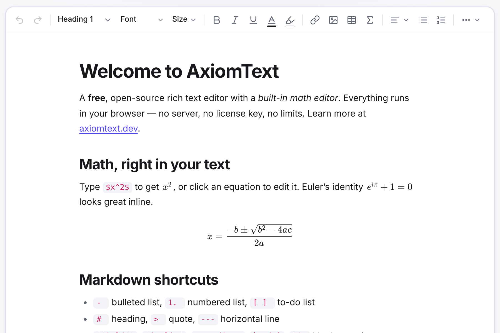
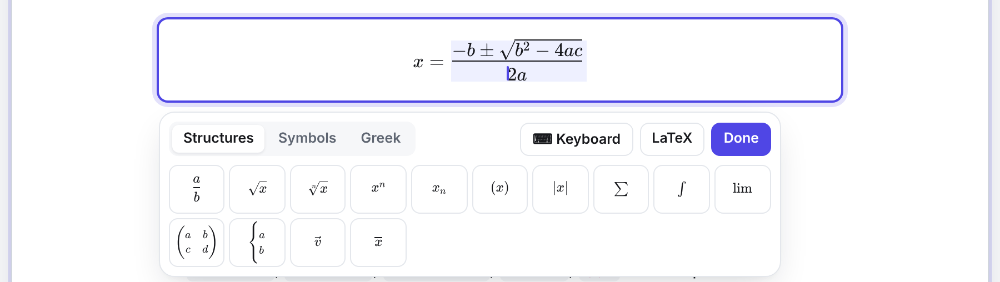

<div align="center">


# AxiomText

**A free, open-source rich text editor with a real math editor built in.**

MIT licensed · runs entirely in the browser · no server, no license key, no limits

[](https://www.npmjs.com/package/@axiomtext/presets)
[](LICENSE)
[](https://github.com/axiomtext/axiomtext/actions/workflows/ci.yml)
[](docs/adr/0008-bundle-budgets.md)

[**Website**](https://axiomtext.dev) · [**Live demo**](https://axiomtext.dev/demo/) · [**Playground**](https://axiomtext.dev/playground/) · [**Docs**](https://axiomtext.dev/start/introduction/)



</div>

---

## Contents

- [Why AxiomText](#why-axiomtext)
- [Features](#features)
- [Quick start](#quick-start)
- [Usage](#usage)
- [Configuration](#configuration)
- [Editor API](#editor-api)
- [Packages](#packages)
- [Browser support, accessibility, security, performance](#quality)
- [Development](#development)
- [Deployment](#deployment)
- [Roadmap](#roadmap)
- [Contributing](#contributing)
- [License & credits](#license--credits)

## Why AxiomText

Most web editors make you choose: a free editor with basic features, or a commercial one where
maths, tables or Word paste are paid add-ons with per-load pricing. AxiomText aims to remove that
choice — every feature is free under the MIT license, including commercial use, and nothing runs
on anyone's server.

Its standout feature is the **math editor**: equations live inside your text and you edit them
**visually** — click a number, an exponent or a fraction and type. LaTeX and AsciiMath are there
when you want them.

<div align="center">

</div>

## Features

| Area           | What you get                                                                                                                                                                                                                                               |
| -------------- | ---------------------------------------------------------------------------------------------------------------------------------------------------------------------------------------------------------------------------------------------------------- |
| **Text**       | Bold, italic, underline, strikethrough, sub/superscript, inline code, font family & size, text colour, highlight, clear formatting                                                                                                                         |
| **Blocks**     | Paragraphs, headings 1–6, quotes, bulleted / numbered / to-do lists, alignment, indentation, horizontal lines, page breaks, columns                                                                                                                        |
| **Tables**     | Insert from a grid, add/remove rows & columns, merge/split cells, header rows, cell colours, column resizing                                                                                                                                               |
| **Images**     | Upload, paste, drag & drop, resize, captions, alt text; wrap modes: in line, left, right, break text, **text on both sides**; move with arrow keys; pluggable upload adapters                                                                              |
| **Math**       | Inline & block equations; **click-to-edit visual editor**; LaTeX with autocomplete; AsciiMath; structure/symbol/Greek palettes; math keyboard; `$…$`, `\(…\)`, `$$` triggers; paste MathML from Wikipedia, ChatGPT, MathJax pages; tested on 500 equations |
| **Writing**    | Markdown shortcuts, undo/redo, word & character count, keyboard shortcuts dialog (Ctrl/⌘ + /), placeholder, read-only mode                                                                                                                                 |
| **Data**       | JSON (lossless, versioned), HTML, Markdown import/export, plain text; autosave to the browser or your server; paste cleanup for Word, Google Docs and web pages                                                                                            |
| **Editors**    | Classic (fixed toolbar), inline (floating toolbar), balloon (toolbar on selection + "+" inserter); headless mode for custom UIs                                                                                                                            |
| **Frameworks** | Vanilla JS, React, Vue, CDN `<script>` / ES module                                                                                                                                                                                                         |
| **Languages**  | UI in English, বাংলা, हिन्दी, العربية, Español, Français, Deutsch, Português, 简体中文, 日本語; right-to-left; IME input                                                                                                                                    |
| **Look**       | Modern UI, light & dark themes, smooth (and reduced-motion-aware) animations, custom icons, CSS variables                                                                                                                                                  |

## Quick start

### npm

```bash
npm install @axiomtext/presets katex
```

```html
<div id="editor"></div>
```

```js
import { createClassicEditor } from '@axiomtext/presets';
import '@axiomtext/ui/styles.css';
import 'katex/dist/katex.min.css';

const { editor } = createClassicEditor({
  element: document.querySelector('#editor'),
  placeholder: 'Start writing…',
});

editor.on('change', () => {
  saveToDatabase(editor.getJSON()); // lossless; load it back with the `content` option
});
```

### CDN (no build step)

```html
<link
  rel="stylesheet"
  href="https://cdn.jsdelivr.net/npm/@axiomtext/presets@0.1/dist/cdn/katex/katex.min.css"
/>
<link
  rel="stylesheet"
  href="https://cdn.jsdelivr.net/npm/@axiomtext/presets@0.1/dist/cdn/axiomtext.css"
/>
<script src="https://cdn.jsdelivr.net/npm/@axiomtext/presets@0.1/dist/cdn/axiomtext.iife.js"></script>

<div id="editor"></div>
<script>
  AxiomText.createClassicEditor({ element: document.querySelector('#editor') });
</script>
```

An ES-module build (maths and languages load on demand) and a form example are in
[`examples/cdn`](examples/cdn). Integrity hashes for each release are in `dist/cdn/sri.json`.

## Usage

### React

```bash
npm install @axiomtext/react katex
```

```jsx
import { AxiomEditor } from '@axiomtext/react';
import '@axiomtext/ui/styles.css';
import 'katex/dist/katex.min.css';

export function PostEditor({ post, onSave }) {
  return <AxiomEditor defaultValue={post.content} onChange={(doc) => onSave(doc)} />;
}
```

Controlled (`value`), `onReady`, `type="balloon"` and a `ref` with the editor API are supported;
works with React 18/19, StrictMode and Next.js client components.

### Vue 3

```bash
npm install @axiomtext/vue katex
```

```vue
<script setup>
import { ref } from 'vue';
import { AxiomEditor } from '@axiomtext/vue';
import '@axiomtext/ui/styles.css';
import 'katex/dist/katex.min.css';

const doc = ref(savedJson);
</script>

<template>
  <AxiomEditor v-model="doc" placeholder="Write something…" />
</template>
```

### Editor types

```js
import { createClassicEditor, createInlineEditor, createBalloonEditor } from '@axiomtext/presets';

createClassicEditor({ element, document: true }); // toolbar + paper-like page + status bar
createInlineEditor({ element: document.querySelector('article') }); // toolbar floats while editing
createBalloonEditor({ element }); // toolbar on selected text, "+" on empty lines
```

### Saving and loading

```js
const json = editor.getJSON(); // store this
const html = editor.getHTML(); // show it on a website
const text = editor.getText(); // search index, previews

editor.setJSON(json); // load (older formats are upgraded automatically)
editor.insertHTML('<p>Pasted <b>content</b></p>'); // cleaned like a paste
```

**Markdown**

```js
import { toMarkdown, fromMarkdown } from '@axiomtext/convert';

const md = toMarkdown(editor.getJSON()); // GFM: tables, task lists, $maths$
editor.setJSON(fromMarkdown('# Hello\n\n$x^2$'));
```

**Autosave**

```js
createClassicEditor({ element, autosave: true }); // draft in the browser, restored on reload

createClassicEditor({
  element,
  content: await loadFromServer(),
  autosave: {
    delay: 2000,
    save: (json) => fetch('/api/doc/42', { method: 'PUT', body: JSON.stringify(json) }),
  },
});
```

### Showing saved content on your website

The saved HTML already contains the rendered equations, so no JavaScript is needed:

```html
<link rel="stylesheet" href="https://cdn.jsdelivr.net/npm/katex@0.19.1/dist/katex.min.css" />
<link rel="stylesheet" href="/css/axiomtext-content.css" />
<!-- copy of @axiomtext/ui/content.css -->

<div class="axiomtext-content">
  <!-- HTML from editor.getHTML() -->
</div>
```

Lists, tables, image wrapping, "text on both sides" and maths then look exactly like in the editor
(and stack nicely on phones). Always sanitize HTML on your server too, or store JSON.

### Image uploads to your server

```js
import { createImagePlugin, createXhrUploadAdapter } from '@axiomtext/plugin-image';
import { ALL_PLUGINS } from '@axiomtext/presets';

const Image = createImagePlugin({
  upload: createXhrUploadAdapter('/api/uploads', { 'X-CSRF-Token': token }), // responds { "url": "…" }
  maxFileSize: 10 * 1024 * 1024,
});

createClassicEditor({
  element,
  plugins: ALL_PLUGINS.map((p) => (p.name === 'image' ? Image : p)),
});
```

Without an adapter, images are embedded in the document (base64) — handy for demos, no server needed.

### Languages and right-to-left

```js
import bn from '@axiomtext/ui/locales/bn'; // ar, hi, es, fr, de, pt, zh, ja

createClassicEditor({ element, language: 'bn', translations: bn });
```

Arabic (and other RTL languages) flip the whole editor; equations stay left-to-right. Your own
translations are a plain object keyed by the English text: `{ Bold: 'Grassetto' }`.

### Choosing features (smaller bundles)

```js
import { createClassicEditor } from '@axiomtext/ui';
import { BasicStyles } from '@axiomtext/plugin-basic-styles';
import { Heading } from '@axiomtext/plugin-heading';
import { List } from '@axiomtext/plugin-list';
import { MathPlugin } from '@axiomtext/math';

createClassicEditor({
  element,
  plugins: [BasicStyles, Heading, List, MathPlugin],
  toolbar: ['undo', 'redo', '|', 'blockStyle', 'bold', 'italic', '|', 'bulletedList', 'math'],
});
```

### Headless (your own UI)

```js
import { createEditor } from '@axiomtext/view';
import { BasicStyles } from '@axiomtext/plugin-basic-styles';

const editor = createEditor({ element, plugins: [BasicStyles] });
boldButton.onclick = () => editor.execute('toggleBold');
editor.on('update', () => boldButton.classList.toggle('active', editor.isActive('bold')));
```

## Configuration

| Option                     | Type                          | Default              | Description                            |
| -------------------------- | ----------------------------- | -------------------- | -------------------------------------- |
| `element`                  | `HTMLElement`                 | —                    | Where the editor is created (required) |
| `plugins`                  | `AxiomPlugin[]`               | all (presets)        | Features to include                    |
| `content`                  | `DocumentJSON`                | empty                | Starting content                       |
| `placeholder`              | `string`                      | —                    | Text shown when empty                  |
| `editable`                 | `boolean`                     | `true`               | `false` for read-only                  |
| `toolbar`                  | `ToolbarItemName[]`           | full toolbar         | Buttons and `'                         | '` separators; extra buttons move into **More** |
| `language`, `translations` | `string`, `object`            | `'en'`               | Interface language                     |
| `autosave`                 | `boolean \| AutosaveOptions`  | off                  | Browser drafts or your save function   |
| `icons`                    | `Record<name, SVG \| string>` | —                    | Replace toolbar icons                  |
| `statusBar`                | `boolean`                     | `true`               | Word count (classic editor)            |
| `document`                 | `boolean`                     | `false`              | Paper-like page (classic editor)       |
| `ariaLabel`                | `string`                      | `'Rich text editor'` | Accessible name                        |

Full reference: [axiomtext.dev/reference/options](https://axiomtext.dev/reference/options/).

## Editor API

| Method                                                                   | Description                                                      |
| ------------------------------------------------------------------------ | ---------------------------------------------------------------- |
| `getJSON()` / `setJSON(doc)`                                             | Read / replace the document                                      |
| `getHTML()` / `getText()`                                                | Export as HTML / plain text                                      |
| `insertHTML(html)` / `insertText(text)`                                  | Insert at the cursor as if pasted                                |
| `execute(command, ...args)` / `can(command)`                             | Run a command (`'toggleBold'`, `'insertTable'`, `'insertMath'`…) |
| `isActive(name, attrs?)`                                                 | Is a format or block active at the cursor                        |
| `undo()` / `redo()`                                                      | History                                                          |
| `focus('start' \| 'end')` / `setEditable(bool)`                          | Focus, read-only                                                 |
| `getStats()`                                                             | `{ words, characters }`, language-aware                          |
| `on('change' \| 'selectionChange' \| 'update' \| 'focus' \| 'blur', fn)` | Events (returns an unsubscribe function)                         |
| `destroy()`                                                              | Remove the editor                                                |

Every command, per plugin: [axiomtext.dev/reference/plugins](https://axiomtext.dev/reference/plugins/).

## Packages

| Package                                  | Description                                                                                                  |
| ---------------------------------------- | ------------------------------------------------------------------------------------------------------------ |
| [`@axiomtext/presets`](packages/presets) | Ready-made classic, inline and balloon editors with every feature; CDN builds                                |
| [`@axiomtext/react`](packages/react)     | React component                                                                                              |
| [`@axiomtext/vue`](packages/vue)         | Vue 3 component with `v-model`                                                                               |
| [`@axiomtext/ui`](packages/ui)           | Toolbars, menus, dialogs, styles (`styles.css`, `content.css`), translations                                 |
| [`@axiomtext/view`](packages/view)       | Headless editor: rendering, input, history, autosave                                                         |
| [`@axiomtext/core`](packages/core)       | Document format, schema, plugin system, sanitizers                                                           |
| [`@axiomtext/math`](packages/math)       | Equations: KaTeX rendering, MathLive visual editing, LaTeX/AsciiMath, MathML paste                           |
| [`@axiomtext/convert`](packages/convert) | Markdown import/export                                                                                       |
| [`@axiomtext/i18n`](packages/i18n)       | Translation runtime and RTL detection                                                                        |
| `@axiomtext/plugin-*`                    | `basic-styles`, `heading`, `list`, `blockquote`, `link`, `font`, `block-format`, `table`, `image`, `columns` |

<a id="quality"></a>

## Browser support, accessibility, security, performance

- **Browsers:** latest two versions of Chrome, Edge, Firefox and Safari, desktop and mobile.
  End-to-end tests run on Chromium, Firefox and WebKit in CI.
- **Accessibility:** WCAG 2.2 AA checked with axe in CI; full keyboard use (Alt+F10 to the toolbar,
  roving focus, shortcuts dialog); screen-reader labels; equations exported with MathML.
- **Security:** pasted and loaded content is filtered by the schema; links (`javascript:` blocked),
  images (no SVG data URLs), colours and fonts are validated; KaTeX runs with `trust: false`;
  the editor makes no network requests of its own. Works with a strict **Content Security Policy**
  and **Trusted Types** (`trusted-types axiomtext ProseMirrorClipboard`). See the
  [security guide](https://axiomtext.dev/guides/security/).
- **Performance** (`pnpm bench`, 1000 paragraphs ≈ 50 000 words): load ≈ 0.2 s, typing p50 ≈ 8 ms
  and p95 ≈ 12 ms per keystroke. KaTeX and MathLive load only when a document uses maths.
- **Bundle size** (gzip): core + view 69 KB, UI 84 KB, math plugin 13 KB, each language ≈ 3 KB.
  Budgets are enforced in CI ([ADR-0008](docs/adr/0008-bundle-budgets.md)).

## Development

Requirements: **Node.js 22** (see `.nvmrc`) and **pnpm 10** (`corepack enable`).

```bash
git clone https://github.com/axiomtext/axiomtext.git
cd axiomtext
pnpm install
pnpm build
pnpm dev            # playground → http://localhost:5173
```

The playground has a language picker, editor-type switch, light/dark theme and a developer panel
showing live JSON, HTML and Markdown. URL options: `?lang=ar`, `?mode=balloon`, `?autosave`,
`?empty`, `?panel`.

| Command                                | What it does                                                                                |
| -------------------------------------- | ------------------------------------------------------------------------------------------- |
| `pnpm check`                           | Format check, lint, typecheck, unit tests, bundle sizes, license check — run before pushing |
| `pnpm test`                            | Unit tests (Vitest); core coverage must stay ≥ 90 %                                         |
| `pnpm test:e2e`                        | End-to-end tests (Playwright; first run `pnpm exec playwright install`)                     |
| `pnpm bench`                           | Performance benchmarks (after `pnpm build`)                                                 |
| `pnpm --filter @axiomtext/website dev` | Docs site → http://localhost:4321                                                           |
| `pnpm changeset`                       | Describe a change for the next release                                                      |

```
apps/playground/     Development app with every feature (also used by e2e tests)
apps/website/        axiomtext.dev — docs, demo, playground (Astro Starlight)
packages/            core, view, ui, math, convert, i18n, presets, react, vue, plugins/*
e2e/                 End-to-end tests: features, accessibility (axe), IME, Trusted Types
benchmarks/          Load and typing performance
corpora/             Test collections: 500 equations, paste samples
deploy/              server setup, deploy-on-push scripts, nginx config, guide
scripts/git-hooks/   pre-push hook that deploys main
docs/                Architecture decisions (ADRs) and progress
examples/            CDN usage examples
```

## Deployment

The website (docs, demo, playground) is static and deploys from your own computer: after a
one-time setup, **`git push` on `main` checks, builds and uploads it** to the server (nginx +
free HTTPS), switches to the new release atomically and only then pushes to GitHub. No GitHub
Actions minutes are used, and `deploy/scripts/deploy-from-laptop.sh --rollback` goes back
instantly. Setup and details: [**deploy/README.md**](deploy/README.md).

Packages are published to npm from your computer with your npm login and 2FA — see
[**RELEASING.md**](RELEASING.md).

## Roadmap

- [x] **M1 — v0.1 alpha:** core editing, tables, images, visual math editor, Markdown, autosave,
      classic/inline/balloon editors, React & Vue, CDN, 10 languages, docs site
- [ ] **M2 — v0.5 beta:** advanced tables, paste from Word/Excel, find & replace, mentions,
      slash menu, code blocks, media embeds, Angular & Svelte, **Flutter SDK beta**
- [ ] **M3 — v1.0:** pagination & page setup, footnotes, table of contents, **Word (DOCX)
      import/export**, PDF export, equation numbering

Progress is tracked in [docs/goal-1/03-progress.md](docs/goal-1/03-progress.md).

## Contributing

Contributions are welcome — bug reports, features, docs and especially **translations reviewed by
native speakers**. Read [CONTRIBUTING.md](CONTRIBUTING.md), run `pnpm check` before opening a pull
request, and add a changeset (`pnpm changeset`) for user-facing changes.

Found a security issue? Please report it privately as described in [SECURITY.md](SECURITY.md).

## License & credits

[MIT](LICENSE) © AxiomText contributors — free for personal and commercial use.

Built on excellent open-source work: [ProseMirror](https://prosemirror.net) (editing),
[KaTeX](https://katex.org) (math rendering), [MathLive](https://mathlive.io) (visual math editing),
[markdown-it](https://github.com/markdown-it/markdown-it) (Markdown) and
[Lucide](https://lucide.dev) (icons) — all MIT or ISC licensed.
